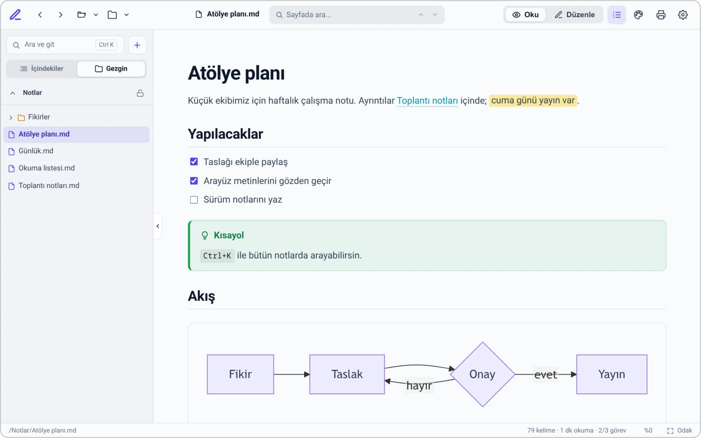
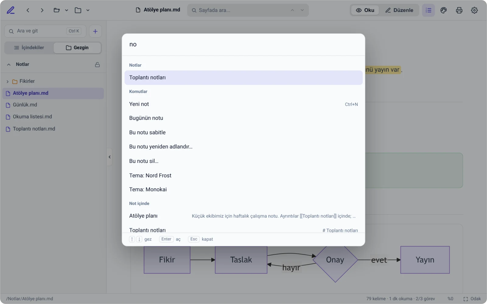
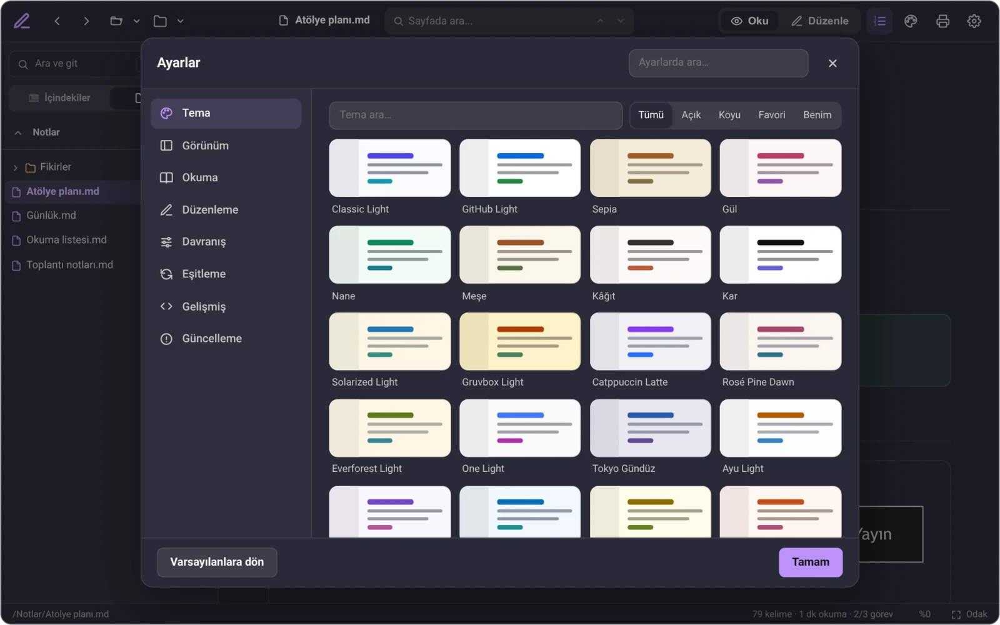
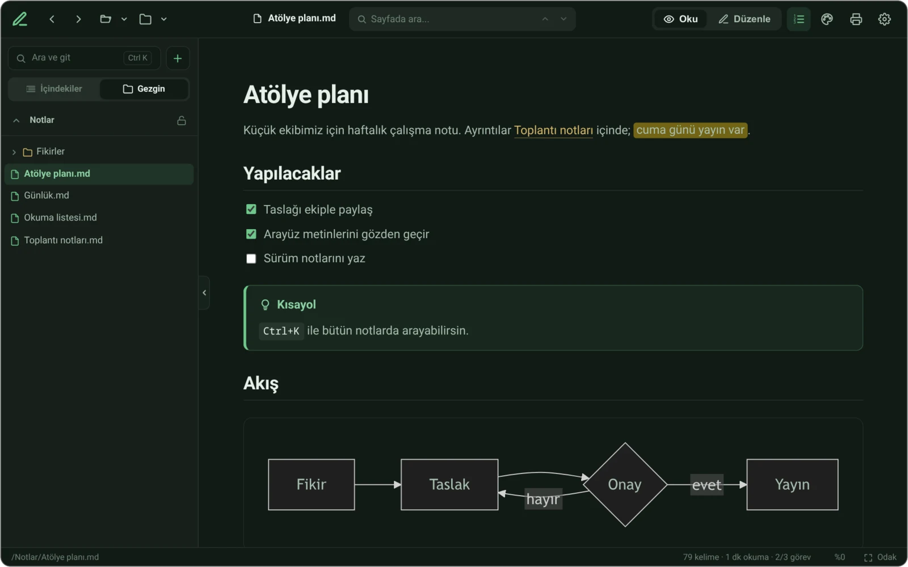
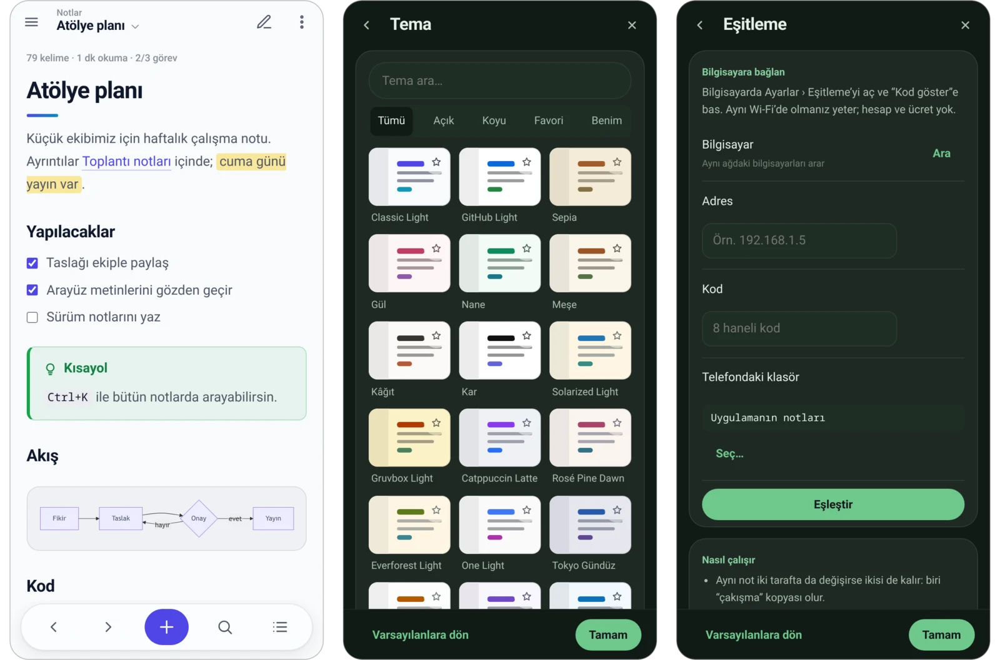
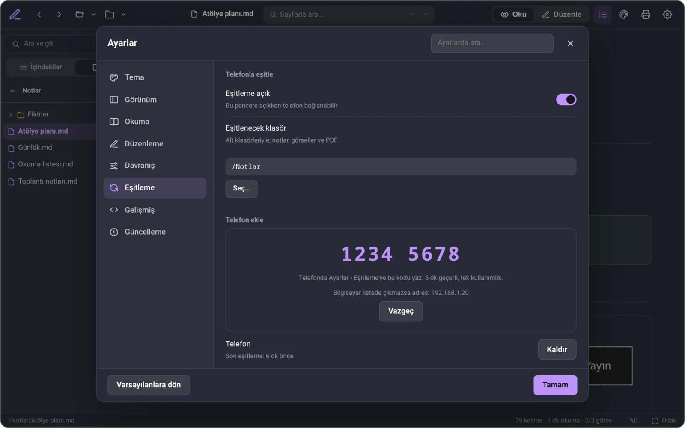

<p align="center">
  
</p>

<h1 align="center">MD Flow Viewer</h1>

<p align="center">
  Hızlı, yerel bir Markdown görüntüleyici ve düzenleyici.<br>
  Windows, macOS, Linux ve Android.
</p>

<p align="center">
  <a href="https://github.com/cafercan/MDViewer/releases/latest"></a>
  <a href="https://github.com/cafercan/MDViewer/actions/workflows/test.yml"></a>
  <a href="LICENSE"></a>
</p>

<p align="center">
  <a href="https://github.com/cafercan/MDViewer/releases/latest"><b>İndir</b></a> ·
  <a href="#özellikler">Özellikler</a> ·
  <a href="#kurulum">Kurulum</a> ·
  <a href="#telefonla-eşitleme">Eşitleme</a> ·
  <a href="docs/GELISTIRME.md">Geliştirme</a>
</p>

<p align="center">
  
</p>

Notlarınız diskinizde düz `.md` dosyaları olarak kalır. Hesap ve sunucu gerekmez.

## Özellikler

| | |
|---|---|
| **Okuma** | Canlı yenileme, içindekiler, Mermaid, kod vurgulama, bilgi kutuları (`> [!NOTE]`), `==vurgu==`, odak modu |
| **Yazma** | Okuma görünümünde yazma (canlı düzenleyici), otomatik kayıt, biçim kısayolları, okurken işaretlenen görev kutuları |
| **Notlar** | Klasör gezgini, sabitlenen notlar, günün notu, `[[wikilink]]` ve nota bağlananlar |
| **Bulma** | Komut paleti, bütün notların içinde arama, sayfa içi arama, son açılanlar |
| **Görünüm** | 60 tema, kendi temanı yapma, vurgu rengi, yazı ve aralık ayarları, özel CSS |
| **Diller** | Türkçe, English, Azərbaycanca, Deutsch, Français, Español, Português, Русский, 日本語, 简体中文 (Ayarlar › Görünüm › Dil) |
| **Diğer** | PDF'e aktarma, telefonla eşitleme, uygulama içinden güncelleme |

### Komut paleti

`Ctrl+K` ile not adı, not içeriği ve komutlar tek kutuda aranır.

<p align="center">
  
</p>

### Temalar ve ayarlar

Galeriden seçin, favorilerinizi işaretleyin ya da kendi temanızı yapın.

<table>
  <tr>
    <td width="50%"></td>
    <td width="50%"></td>
  </tr>
</table>

### Android

Aynı notlar, telefona göre düzenlenmiş arayüz: biçim çubuğu, paylaşılan metinden not ve ana ekran kısayolları.

<p align="center">
  
</p>

## Kurulum

Paketler [son sürüm sayfasındadır](https://github.com/cafercan/MDViewer/releases/latest).

| Sistem | Dosya | Kurulum |
|---|---|---|
| **Windows** x64 | `.exe` | Çalıştırın. [WebView2](https://developer.microsoft.com/microsoft-edge/webview2/) gerekir; Windows 11'de hazır gelir |
| **macOS** 11+, Apple Silicon | `.dmg` | Uygulamayı Applications klasörüne sürükleyin, [ilk açılış notuna](#macosta-ilk-açılış) bakın |
| **Debian / Ubuntu** 22.04+ | `.deb` | `sudo apt install ./mdflowviewer_*_amd64.deb` |
| **Fedora / RHEL** | `.rpm` | `sudo dnf install ./mdflowviewer-*.x86_64.rpm` |
| **openSUSE** | `.rpm` | `sudo zypper install ./mdflowviewer-*.x86_64.rpm` |
| **Arch / Manjaro** | `.pkg.tar.zst` | `sudo pacman -U mdflowviewer-bin-*.pkg.tar.zst` |
| **Android** | `.apk` | Dosyayı telefonda açıp kurun |

Arch için AUR'da `mdflowviewer` ve `mdflowviewer-bin` de var; AUR sürümü geriden gelebilir.

Bir `.md` dosyasına sağ tıklayıp **Birlikte Aç → MD Flow Viewer** ile açabilirsiniz.

### macOS'ta ilk açılış

Uygulama Apple Developer kimliğiyle imzalı olmadığından macOS ilk açılışı engeller. **Sistem Ayarları → Gizlilik ve Güvenlik → Yine de Aç** deyin ya da bir kez şunu çalıştırın:

```bash
xattr -dr com.apple.quarantine "/Applications/MD Flow Viewer.app"
```

[C Launcher](https://github.com/cafercan/c-launcher) ile kurulumda bu uyarı çıkmaz.

## Telefonla eşitleme

<p align="center">
  
</p>

1. Bilgisayarda **Ayarlar › Eşitleme**'yi açın, klasörü seçin ve **Kod göster**'e basın.
2. Telefonda **Ayarlar › Eşitleme**'de **Ara**'ya basın ya da adresi yazın, kodu girin, **Eşleştir**'e basın. Olmazsa hangi adımda takıldığı ve ne yapılacağı ekranda yazar.

İki cihaz aynı yerel ağda ya da aynı Tailscale ağında olmalı, iki uygulama da açık olmalıdır. Telefon 45 saniyede bir ve not kaydedince eşitler. Bir not iki tarafta da değişmişse ikisi de saklanır. Bağlanmıyorsa güvenlik duvarında 47823 (TCP ve UDP) kapısına izin verin.

## Kısayollar

| Kısayol | İş | Kısayol | İş |
|---|---|---|---|
| `Ctrl+K` | Komut paleti | `Ctrl+O` | Dosya aç |
| `Ctrl+N` | Yeni not | `Ctrl+Shift+O` | Klasör aç |
| `Ctrl+F` | Sayfada ara | `Ctrl+P` | PDF'e aktar |
| `Ctrl+,` | Ayarlar | `F9` | Odak modu |
| `Alt+←` / `Alt+→` | Geri / ileri | `Ctrl+B` / `Ctrl+I` | Kalın / italik (düzenlerken) |

## Güvenlik

- Eşitleme varsayılan olarak kapalıdır; kapalıyken ağ portu açılmaz. Açıkken yalnız özel ağ adresleri kabul edilir ve bağlantı uçtan uca şifrelidir.
- Belgeler DOMPurify ile temizlenir; dosya erişimi belge klasörü ve gezgin köküyle sınırlıdır.
- Güncellemeler kurulmadan önce SHA-256 ile doğrulanır.

Ayrıntılar: [güvenlik modeli](docs/GELISTIRME.md#güvenlik-modeli).

## Geliştirme

Arayüz saf HTML/CSS/JS, kabuk Rust ve [Tauri 2](https://tauri.app).

```bash
npm install
npx tauri dev
```

Mimari, testler ve paketleme: [docs/GELISTIRME.md](docs/GELISTIRME.md).

## Lisans

[MIT](LICENSE)
