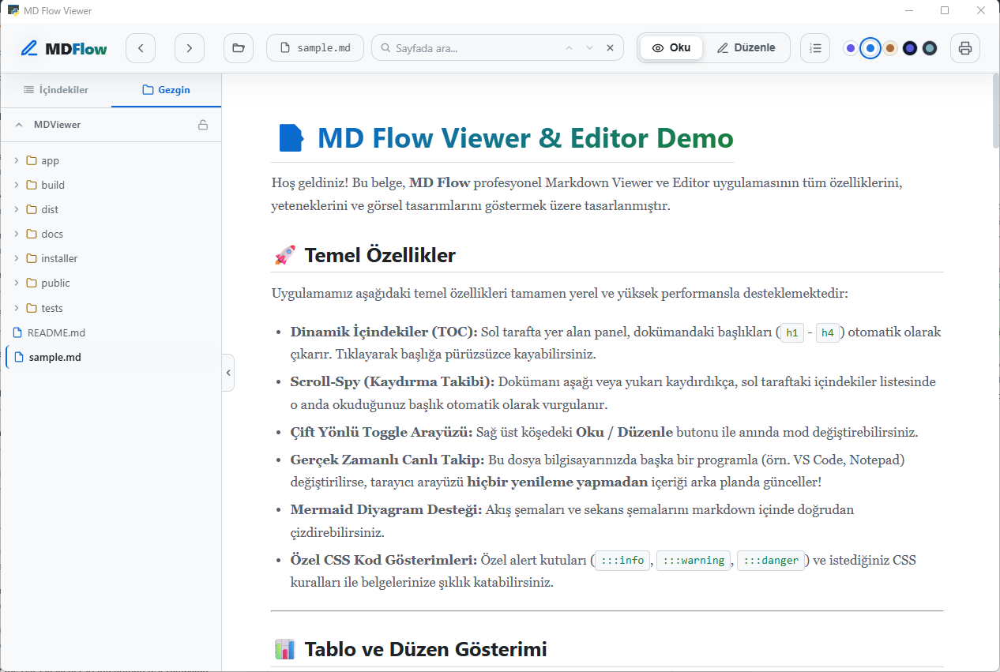

# MD Flow Viewer

Windows, macOS ve Linux için hızlı, yerel bir **Markdown görüntüleyici ve düzenleyici**.
Dosyayı diskte değiştirdiğinizde otomatik yenilenir (canlı takip), Mermaid
diyagramlarını ve kod vurgulamasını yerleşik olarak çizer, blok blok düzenlemeye
izin verir.

`.md` / `.markdown` dosyalarına çift tıklayınca **kendi penceresinde** açılır —
kendi görev çubuğu ikonuyla, tarayıcı sekmesi gibi değil.

<p align="center">
  
</p>

## Özellikler

- 📄 Canlı önizleme; sol kenar çubuğu 2 sekme: **İçindekiler** (TOC) ve **Gezgin**
- 🗂️ **Gezgin**: Obsidian tarzı klasör ağacı (yalnız `.md`), ↑ ile üst klasöre çık, klasöre üç tık ile içine in; kilit ile klasörü **vault** olarak sabitle (kalıcı)
- ✏️ Blok bazlı satır içi düzenleyici, otomatik kaydetme
- 🔄 Dosya diskte değişince otomatik yenileme (SSE)
- 🧜 Mermaid diyagramları, `highlight.js` kod vurgulama
- 🎨 `:::info` `:::warning` `:::danger` kutuları
- 🖼️ Belgeye göreli yerel görselleri servis eder
- 🪟 **Kendi penceresi** (pywebview; Windows'ta WebView2, Linux'ta WebKitGTK) — kendi ikonu, kapanınca temiz çıkış
- 📂 Üst bardan **dosya aç** (Ctrl+O) — native seçici son açılan klasörde başlar
- 🗃️ Üst bardan **klasör (çalışma alanı) aç** (Ctrl+Shift+O) — seçilen klasör hem belge kökü hem gezgin kökü olur; vault kilidi açıksa kilit de o klasöre taşınır
- 🕘 Aç düğmelerinin yanındaki oklardan **son açılan 10 dosya / 10 klasör** listesi (ayar dosyasında kalıcı, silinmiş yollar elenir, "Listeyi temizle")
- 📋 Gezginde dosyaya **sağ tık → Tam yolu kopyala**
- 🔗 Belge içi bağlantılar: göreli `.md` bağlantıları uygulama içinde açılır, `#başlık` kaydırır, http(s) sistem tarayıcısına, diğer yerel dosyalar varsayılan uygulamaya gider; klasör bağlantısı (`[planning/](planning/)`) klasör notunu (README/index/_index/<ad>.md) açar, yoksa Gezgin'de gösterir, Ctrl+tık sistemin dosya yöneticisi (Windows Gezgini / Nautilus vb.); üst barda Geri/İleri (Alt+←/→)
- 🧭 Obsidian tarzı `[[wikilink]]`: `[[not]]`, `[[not|takma ad]]`, `[[not#başlık]]`, `[[klasör/not]]`, `![[görsel.png]]`; hedef belgenin klasöründe, sonra gezgin kökünde (vault) dosya adıyla aranır
- 🏷️ Belge başındaki YAML frontmatter (`---` … `---`) anahtar/değer tablosu olarak gösterilir
- 🔍 Üst barda sayfa içi arama: Enter/Shift+Enter veya mini oklarla sonraki/önceki (Ctrl+F)
- 🖨️ PDF olarak dışa aktarma (Ctrl+P) — çıktıda üst bar/kenar çubuğu yok
- 🔢 Satır numaraları (yalnızca düzenleme modu), üst bardan aç/kapa
- 🎨 5 tema (3 açık + 2 koyu) üst barda renk swatch'leriyle; varsayılan açık
- 🎚️ Tema ve satır no tercihi kalıcı (sonraki açılışlarda korunur)
- 🔒 Yalnızca `127.0.0.1` dinler; dosya erişimi belge klasörü + gezgin kökü ile sınırlı, kök yalnız uygulama penceresinden genişler

## Kurulum — Windows

1. [Releases](https://github.com/cafercan/MDViewer/releases) sayfasından
   **`MDViewer-v2.9.2.exe`** kurulumunu indirin.
2. Çalıştırın. Kurulum klasörünü seçebilir, `Program Files`'a kurabilirsiniz.
3. Bir `.md` dosyasına **sağ tıklayın → Birlikte Aç → MD Flow Viewer**. İsterseniz
   "Her zaman bu uygulamayı kullan" ile varsayılan yapabilirsiniz.

Kurulum **Ekle/Kaldır Programlar** listesinde **MDViewer** olarak görünür ve
temiz kaldırılır (dosya ilişkilendirmeleri dahil).

### Gereksinim

- **Windows x64**
- **Microsoft Edge WebView2 Runtime** — Windows 11'de yerleşik gelir. Yoksa
  kurulum uyarır: <https://developer.microsoft.com/microsoft-edge/webview2/>
- Python veya Node.js **gerekmez** — uygulama tek exe olarak paketlidir.

## Kurulum — macOS (Apple Silicon)

En kolayı [C Launcher](https://github.com/cafercan/c-launcher): uygulamayı indirip
`Uygulamalar` klasörüne kurar, güncellemeleri de yapar; aşağıdaki güvenlik uyarısı çıkmaz.

Elle kurulum:

1. [Releases](https://github.com/cafercan/MDViewer/releases) sayfasından
   **`MDViewer-v2.9.2-macos-arm64.dmg`** dosyasını indirin.
2. Açın ve **MD Flow Viewer**'ı **Applications** klasörüne sürükleyin.
3. Uygulama Apple Developer kimliğiyle imzalı olmadığı için macOS ilk açılışta
   engeller. **Sistem Ayarları → Gizlilik ve Güvenlik** altındaki **Yine de Aç**
   düğmesine basın ya da Terminal'de bir kez şunu çalıştırın:

   ```bash
   xattr -dr com.apple.quarantine "/Applications/MD Flow Viewer.app"
   ```

4. Bir `.md` dosyasına sağ tık → **Birlikte Aç → MD Flow Viewer**.

Gereksinim: Apple Silicon (M1 ve sonrası), macOS 11 veya üzeri. Intel Mac için paket
yok. Ayarlar `~/.config/MDFlowViewer/` altında tutulur.

## Kurulum — Linux (Debian / Ubuntu)

1. [Releases](https://github.com/cafercan/MDViewer/releases) sayfasından
   **`mdflowviewer_2.9.2_all.deb`** paketini indirin.
2. Kurun (bağımlılıklar apt ile otomatik gelir):

   ```bash
   sudo apt install ./mdflowviewer_2.9.2_all.deb
   ```

3. Uygulama menüsünde **MD Flow Viewer** görünür. Bir `.md` dosyasına sağ tık →
   **Birlikte Aç → MD Flow Viewer**; varsayılan yapmak için dosya özelliklerinden
   ya da `xdg-mime default mdflowviewer.desktop text/markdown`.
   Terminalden: `mdflowviewer dosya.md`.

Kaldırma: `sudo apt remove mdflowviewer`. Ayarlar `~/.config/MDFlowViewer/`
altında tutulur.

Paket saf Python'dur (`Architecture: all`); `python3-flask`, `python3-webview`
ve WebKitGTK (`gir1.2-webkit2-4.1`) dağıtım paketlerinden gelir. Ubuntu 26.04 üzerinde
test edildi (`python3-webview` universe deposundadır).

## Mimari

Üç katman; arayüz saf web (HTML/CSS/JS), kabuk native:

- **Frontend** — `public/` (marked, mermaid, highlight.js, DOMPurify). Çizilen
  HTML DOMPurify ile sanitize edilir, Mermaid `strict` modda.
- **Backend** — `app/server.py`: `127.0.0.1`'de küçük Flask sunucusu; `/api/*`
  uçları (content, save, files, asset, settings, watch/SSE). Tüm dosya erişimi açılan
  belgenin klasörüne **hapsedilir** (path traversal `403`).
- **Kabuk** — `app/main.py`: pywebview ile kendi WebView2 penceresi. Native
  dosya seçici `JsApi` köprüsüyle açılır; seçilen belgenin klasörü yeni çalışma
  kökü olur. Pencere kapanınca süreç tamamen biter; arka planda sunucu kalmaz.

## Geliştirme

```bash
python -m venv .venv
.venv\Scripts\pip install -r requirements.txt
.venv\Scripts\python app\main.py path\to\dosya.md
```

## Kaynaktan derleme (installer)

```powershell
# 1) Bağımlılıklar
.venv\Scripts\pip install -r requirements.txt

# 2) Tek exe (PyInstaller one-dir) -> dist\MDFlowViewer\
.\build.ps1

# 3) Inno Setup ile kurulum -> dist\MDViewer-v2.9.2.exe
& "C:\Program Files (x86)\Inno Setup 6\ISCC.exe" installer\MDFlowViewer.iss
```

### Linux (.deb)

```bash
bash packaging/linux/build-deb.sh     # -> dist/mdflowviewer_2.9.2_all.deb
```

Sürüm `installer/MDFlowViewer.iss` içindeki `AppVersion`'dan okunur.
Kaynaktan çalıştırmak için: `sudo apt install python3-flask python3-webview
gir1.2-webkit2-4.1` ve `python3 app/main.py dosya.md`.

## Güvenlik modeli

Yerel bir araç olsa da güvenilmeyen `.md` dosyalarına karşı sertleştirildi:
DOMPurify sanitizasyonu + Mermaid strict, yalnızca loopback dinleme, ve dosya
API'lerinde **kök hapsi** (belge klasörü dışına okuma/yazma reddedilir).

## Lisans

[MIT](LICENSE)
