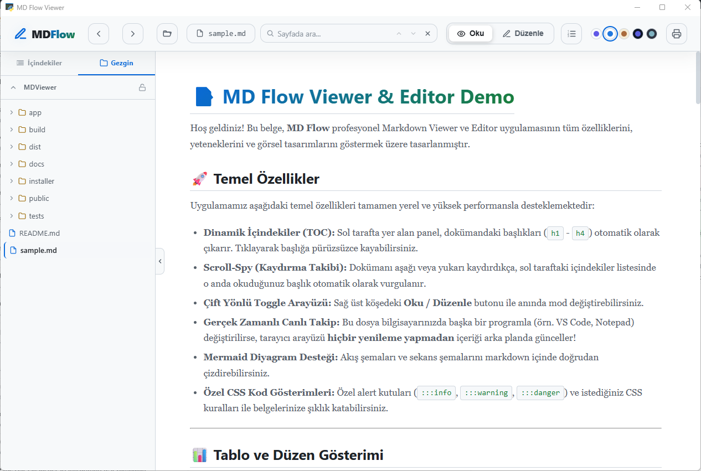

# MD Flow Viewer

Windows, macOS ve Linux için hızlı, yerel bir **Markdown görüntüleyici ve düzenleyici**.
Dosyayı diskte değiştirdiğinizde otomatik yenilenir (canlı takip), Mermaid
diyagramlarını ve kod vurgulamasını yerleşik olarak çizer, blok blok düzenlemeye
izin verir.

`.md` / `.markdown` dosyalarına çift tıklayınca **kendi penceresinde** açılır —
kendi görev çubuğu ikonuyla, tarayıcı sekmesi gibi değil.

<p align="center">
  
</p>

## Özellikler

- 📄 Canlı önizleme; sol kenar çubuğu 2 sekme: **İçindekiler** (TOC) ve **Gezgin**
- 🗂️ **Gezgin**: Obsidian tarzı klasör ağacı (yalnız `.md`), ↑ ile üst klasöre çık, klasöre üç tık ile içine in; kilit ile klasörü **vault** olarak sabitle (kalıcı)
- ✏️ Blok bazlı satır içi düzenleyici, otomatik kaydetme
- 🔄 Dosya diskte değişince otomatik yenileme (SSE)
- 🧜 Mermaid diyagramları, `highlight.js` kod vurgulama
- 🎨 `:::info` `:::warning` `:::danger` kutuları
- 🖼️ Belgeye göreli yerel görselleri servis eder
- 🪟 **Kendi penceresi** (Tauri; Windows'ta WebView2, macOS'ta WebKit, Linux'ta WebKitGTK) — kendi ikonu, konumu ve boyutu hatırlanır
- 📂 Üst bardan **dosya aç** (Ctrl+O) — native seçici son açılan klasörde başlar
- 🗃️ Üst bardan **klasör (çalışma alanı) aç** (Ctrl+Shift+O) — seçilen klasör hem belge kökü hem gezgin kökü olur; vault kilidi açıksa kilit de o klasöre taşınır
- 🕘 Aç düğmelerinin yanındaki oklardan **son açılan 10 dosya / 10 klasör** listesi (ayar dosyasında kalıcı, silinmiş yollar elenir, "Listeyi temizle")
- 📋 Gezginde dosyaya **sağ tık → Tam yolu kopyala**
- 🔗 Belge içi bağlantılar: göreli `.md` bağlantıları uygulama içinde açılır, `#başlık` kaydırır, http(s) sistem tarayıcısına, diğer yerel dosyalar varsayılan uygulamaya gider; klasör bağlantısı (`[planning/](planning/)`) klasör notunu (README/index/_index/<ad>.md) açar, yoksa Gezgin'de gösterir, Ctrl+tık sistemin dosya yöneticisi (Windows Gezgini / Nautilus vb.); üst barda Geri/İleri (Alt+←/→)
- 🧭 Obsidian tarzı `[[wikilink]]`: `[[not]]`, `[[not|takma ad]]`, `[[not#başlık]]`, `[[klasör/not]]`, `![[görsel.png]]`; hedef belgenin klasöründe, sonra gezgin kökünde (vault) dosya adıyla aranır
- 🏷️ Belge başındaki YAML frontmatter (`---` … `---`) anahtar/değer tablosu olarak gösterilir
- 🔍 Üst barda sayfa içi arama: Enter/Shift+Enter veya mini oklarla sonraki/önceki (Ctrl+F)
- 🖨️ PDF olarak dışa aktarma (Ctrl+P) — çıktıda üst bar/kenar çubuğu yok
- 🔢 Satır numaraları (yalnızca düzenleme modu), üst bardan aç/kapa
- 🎨 5 tema (3 açık + 2 koyu) üst barda renk swatch'leriyle; varsayılan açık
- 🎚️ Tema ve satır no tercihi kalıcı (sonraki açılışlarda korunur)
- 📥 Pencereye `.md` dosyası sürükleyince açılır, klasör sürükleyince çalışma alanı olur
- 💾 Kaydederken dosyanın satır sonu (CRLF/LF) ve BOM'u korunur; kayıt atomiktir (yarım dosya kalmaz)
- 🔒 Ağ portu açmaz; dosya erişimi belge klasörü + gezgin kökü ile sınırlı, kök yalnız uygulama penceresinden genişler

## Kurulum — Windows

1. [Releases](https://github.com/cafercan/MDViewer/releases) sayfasından
   **`MDViewer-v3.0.2.exe`** kurulumunu indirin.
2. Çalıştırın. Kurulum klasörünü seçebilir, `Program Files`'a kurabilirsiniz.
3. Bir `.md` dosyasına **sağ tıklayın → Birlikte Aç → MD Flow Viewer**. İsterseniz
   "Her zaman bu uygulamayı kullan" ile varsayılan yapabilirsiniz.

Kurulum **Ekle/Kaldır Programlar** listesinde **MDViewer** olarak görünür ve
temiz kaldırılır (dosya ilişkilendirmeleri dahil).

### Gereksinim

- **Windows x64**
- **Microsoft Edge WebView2 Runtime** — Windows 11'de yerleşik gelir. Yoksa
  kurulum uyarır: <https://developer.microsoft.com/microsoft-edge/webview2/>
- Python veya Node.js **gerekmez** — uygulama tek exe olarak paketlidir (~4 MB kurulum).
- 2.x kuruluysa 3.0 kurulumu onun üstüne yükseltme olarak kurulur; ayarlar,
  son açılanlar ve vault korunur.

## Kurulum — macOS (Apple Silicon)

En kolayı [C Launcher](https://github.com/cafercan/c-launcher): uygulamayı indirip
`Uygulamalar` klasörüne kurar, güncellemeleri de yapar; aşağıdaki güvenlik uyarısı çıkmaz.

Elle kurulum:

1. [Releases](https://github.com/cafercan/MDViewer/releases) sayfasından
   **`MDViewer-v3.0.2-macos-arm64.dmg`** dosyasını indirin.
2. Açın ve **MD Flow Viewer**'ı **Applications** klasörüne sürükleyin.
3. Uygulama Apple Developer kimliğiyle imzalı olmadığı için macOS ilk açılışta
   engeller. **Sistem Ayarları → Gizlilik ve Güvenlik** altındaki **Yine de Aç**
   düğmesine basın ya da Terminal'de bir kez şunu çalıştırın:

   ```bash
   xattr -dr com.apple.quarantine "/Applications/MD Flow Viewer.app"
   ```

4. Bir `.md` dosyasına sağ tık → **Birlikte Aç → MD Flow Viewer**.

Gereksinim: Apple Silicon (M1 ve sonrası), macOS 11 veya üzeri. Intel Mac için paket
yok. Ayarlar `~/.config/MDFlowViewer/` altında tutulur.

## Kurulum — Linux (Debian / Ubuntu)

1. [Releases](https://github.com/cafercan/MDViewer/releases) sayfasından
   **`mdflowviewer_3.0.2_amd64.deb`** paketini indirin.
2. Kurun (bağımlılıklar apt ile otomatik gelir):

   ```bash
   sudo apt install ./mdflowviewer_3.0.2_amd64.deb
   ```

3. Uygulama menüsünde **MD Flow Viewer** görünür. Bir `.md` dosyasına sağ tık →
   **Birlikte Aç → MD Flow Viewer**; varsayılan yapmak için dosya özelliklerinden
   ya da `xdg-mime default mdflowviewer.desktop text/markdown`.
   Terminalden: `mdflowviewer dosya.md`.

Kaldırma: `sudo apt remove mdflowviewer`. Ayarlar `~/.config/MDFlowViewer/`
altında tutulur.

Paket tek ikilidir (`/usr/bin/mdflowviewer`, `amd64`); WebKitGTK
(`libwebkit2gtk-4.1-0`) ve GTK dağıtım paketlerinden gelir. 2.x'in Python
paketini (`_all.deb`) yükseltir. Ubuntu 22.04 ve üzeri.

## Kurulum — Linux (Fedora / openSUSE / RHEL)

[Releases](https://github.com/cafercan/MDViewer/releases) sayfasından
**`mdflowviewer-3.0.2-1.x86_64.rpm`** paketini indirip kurun:

```bash
sudo dnf install ./mdflowviewer-3.0.2-1.x86_64.rpm      # Fedora / RHEL
sudo zypper install ./mdflowviewer-3.0.2-1.x86_64.rpm   # openSUSE
```

Kütüphane bağımlılıkları (WebKitGTK 4.1, GTK 3) paket yöneticisiyle gelir.

## Kurulum — Linux (Arch / Manjaro)

AUR'da iki paket var: `mdflowviewer` (kaynaktan derler) ve `mdflowviewer-bin`
(Release'teki hazır ikili):

```bash
yay -S mdflowviewer-bin      # ya da: paru -S mdflowviewer
```

AUR'a gerek olmadan, depodaki PKGBUILD ile:

```bash
cd packaging/arch/mdflowviewer && makepkg -si
```

## Mimari

Arayüz saf web (HTML/CSS/JS), kabuk Rust (Tauri 2):

- **Frontend** — `public/` (marked, mermaid, highlight.js, DOMPurify). Çizilen
  HTML DOMPurify ile sanitize edilir, Mermaid `strict` modda ve yalnız diyagramlı
  belgede (ya da pencere boştayken) yüklenir. `public/bridge.js` uygulama
  komutlarına (`invoke`) köprüdür.
- **Çekirdek** — `core/` (`mdflow-core`): Tauri'den bağımsız, birim testli
  mantık — ayar dosyası, kök hapsi ve gezgin, wikilink çözümü, satır sonu/BOM
  koruyan atomik belge okuma/yazma.
- **Kabuk** — `src-tauri/`: pencere, IPC komutları, belgeye göreli görseller
  için `mdasset://` protokolü, dosya izleyici (atomik kaydeden editörlere
  dayanıklı), gezinme koruması. Ağ portu açılmaz; komutlar yalnız ana pencereye
  izinlidir (`src-tauri/capabilities/default.json`).

## Geliştirme

Gerekenler: Rust (stable), Node.js 22; Linux'ta `libwebkit2gtk-4.1-dev`,
`libgtk-3-dev`, `librsvg2-dev`.

```bash
npm install
npx tauri dev                    # pencereyi kaynaktan aç
cargo test --workspace           # Rust testleri
node --test tests/*.test.js      # arayüz yardımcılarının testleri
```

Komut satırından belgeyle açmak için derlenmiş ikiliye yolu verin:
`mdflowviewer dosya.md`.

## Kaynaktan derleme (kurulum)

Sürüm tek yerden gelir: `src-tauri/tauri.conf.json` içindeki `version`.
Betikler exe'yi cargo'nun hedef klasöründen alır (`cargo metadata`), bu klasör
bir cargo ayarıyla repo dışına taşınmış olabilir.

```powershell
# Windows (Inno Setup 6 gerekir) -> dist\MDViewer-v<sürüm>.exe
.\scripts\build-installer.ps1
```

```bash
bash packaging/linux/build-deb.sh     # -> dist/mdflowviewer_<sürüm>_amd64.deb
bash packaging/linux/build-rpm.sh     # -> dist/mdflowviewer-<sürüm>-1.x86_64.rpm
bash packaging/macos/build-dmg.sh     # -> dist/MDViewer-v<sürüm>-macos-arm64.dmg
```

## Güvenlik modeli

Yerel bir araç olsa da güvenilmeyen `.md` dosyalarına karşı sertleştirildi:
DOMPurify sanitizasyonu + Mermaid strict, ağ portu yok, sıkı CSP, pencerenin
uygulama dışına gezinmesi engelli (dış bağlantılar sistem tarayıcısında açılır)
ve dosya komutlarında **kök hapsi** (belge klasörü dışına okuma/yazma reddedilir).

## Lisans

[MIT](LICENSE)
