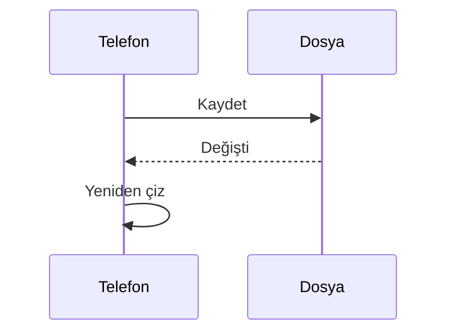

# Markdown örnekleri

Bu sayfa görüntüleyicinin neleri çizdiğini gösterir. Düzenleme moduna geçip
her bloğun ham halini görebilirsiniz.

## Metin

**Kalın**, *eğik*, ~~üstü çizili~~, `satır içi kod` ve
[dış bağlantı](https://github.com/cafercan/MDViewer).

> Alıntılar böyle görünür.

- [x] Yapıldı
- [ ] Yapılacak
  - İç içe madde

## Kod

```rust
fn main() {
    let notlar = vec!["bir", "iki", "üç"];
    for (i, not) in notlar.iter().enumerate() {
        println!("{i}: {not}");
    }
}
```

## Tablo

| Tuş | İşlev | Not |
| :--- | :---: | ---: |
| Liste | Notlar | sağa kaydır |
| Kalem | Düzenle | otomatik kayıt |
| Büyüteç | Sayfada ara | Türkçe harf duyarsız |

## Kutular

:::info
Bilgi kutusu.
:::

:::warning
Uyarı kutusu.
:::

:::danger
Tehlike kutusu.
:::

## Diyagram



Geri dön: [[Hoş geldiniz]]
