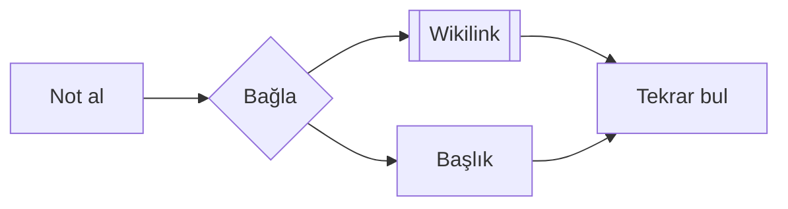

# MD Flow Viewer

Markdown notlarınız artık cebinizde. Bu not uygulamanın kendi **Notlar**
klasöründe duruyor; dilediğiniz gibi düzenleyin ya da silin.

:::info
Telefonunuzdaki bir klasörü açmak için listenin üstündeki klasör adına, sonra
**Klasör aç**'a dokunun. İlk seferde Android "tüm dosyalara erişim" iznini sorar.
:::

## Nasıl kullanılır

- **Liste** — bütün notlarınız. Nottan listeye geri tuşuyla ya da sayfayı sağa
  kaydırarak dönersiniz.
- **Kalem** — yazmaya başlar; değişiklikler kendiliğinden kaydedilir. **✓** bitirir.
- **＋** — yeni not.
- **⋮** — notta ara, başlıklar, paylaş, sil.
- **Nota ya da klasöre uzun bas** — o satırın işlemleri.

## Neler var

| Özellik | Örnek |
| --- | --- |
| Wikilink | [[Markdown örnekleri]] |
| Kod vurgulama | `fn main() {}` |
| Diyagram | Mermaid |
| Tema | 60 tema, sistemle birlikte koyu/açık |

Devamı için: [[Markdown örnekleri]] ve [[Günlük]].
