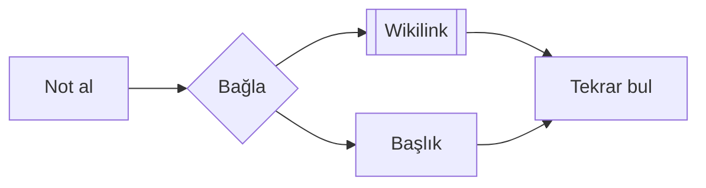

# MD Flow Viewer

Markdown notlarınız artık cebinizde. Bu not uygulamanın kendi **Notlar**
klasöründe duruyor; dilediğiniz gibi düzenleyin ya da silin.

:::info
Telefonunuzdaki bir klasörü açmak için sol üstteki menüden **Klasör aç**'a
dokunun. İlk seferde Android "tüm dosyalara erişim" iznini sorar.
:::

## Nasıl kullanılır

- **☰ Menü** — dosya gezgini ve içindekiler. Sayfayı sağa kaydırarak da
  açılır.
- **Başlığa dokun** — klasördeki bütün notlar arasında ada göre hızlı geçiş.
- **Kalem** — düzenleme modu. Bir paragrafa dokunun, yazın; değişiklikler
  kendiliğinden kaydedilir.
- **＋** — bulunduğunuz klasörde yeni not.
- **Klasöre uzun bas** — o klasörü kök yap ya da içine not ekle.
- **Geri tuşu** — açık paneli kapatır, sonra önceki nota döner.

## Neler var

| Özellik | Örnek |
| --- | --- |
| Wikilink | [[Markdown örnekleri]] |
| Kod vurgulama | `fn main() {}` |
| Diyagram | Mermaid |
| Tema | 10 tema, sistemle birlikte koyu/açık |

Devamı için: [[Markdown örnekleri]] ve [[Günlük]].
